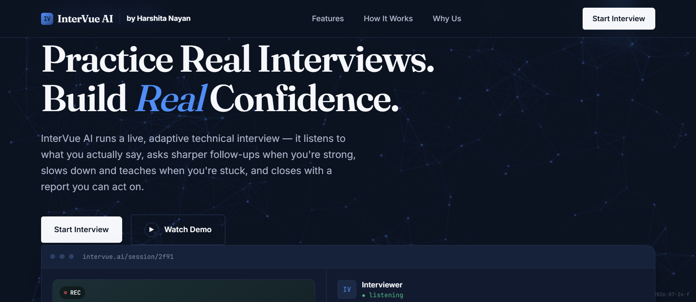
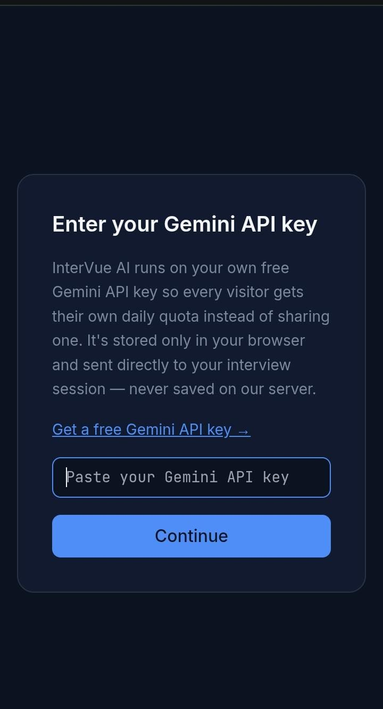
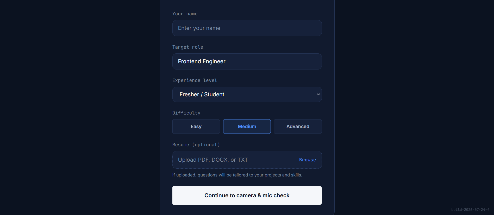
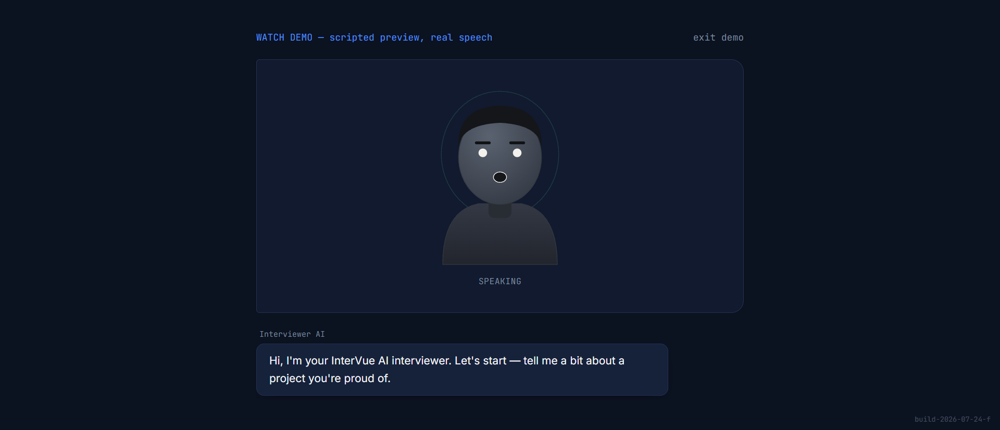
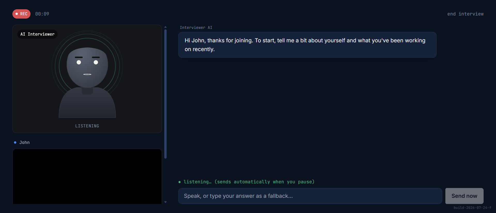

# 🎤 InterVue AI

An adaptive AI interview simulator for students and software engineers practicing technical interviews.

**[Try the live demo](https://intervue-ai-85b1.onrender.com)**

## 💡 What it does

- 🗣️ Conducts a voice-based technical interview with an animated AI interviewer (6–10 questions, approximately 10–15 minutes).
- 🎯 Adapts question difficulty and follow-ups based on how you answer.
- 📄 Optionally reads your resume to personalize questions to your background.
- 🧠 Explains concepts on the spot in teaching mode when you’re unsure.
- 📊 Generates a scored performance report at the end.

## 📸 Screenshots

### Home page

The starting point for interview practice and the guided demo.



### Bring Your Own Key (BYOK)

Enter your own Gemini API key before starting an AI-powered interview.



### Interview setup

Choose your target role, experience level, and difficulty. Upload a resume optionally to personalize your session.



### Guided demo

A scripted preview with speech shows how the animated interviewer works.



### Live interview

Practice with the AI interviewer using voice input or type your answers as a fallback.



## 🛠️ Tech stack

| Layer | Technologies |
| --- | --- |
| Client | React, Vite, Tailwind CSS, Framer Motion |
| Server | Node.js, Express |
| AI | Google Gemini API |
| Voice input and output | Web Speech API |

## 🔑 Bring Your Own Key (BYOK)

Each visitor enters their own Gemini API key in the browser and uses their own API quota. The key is stored in that browser and sent to the backend for interview requests; it is not saved persistently on the server.

Get a key from [Google AI Studio](https://aistudio.google.com/apikey). Available models and usage limits depend on your Google account and API plan.

Never commit your API key or a secret `.env` file to GitHub.

## 🚀 Running locally

Install Node.js and npm before starting. Open a terminal in the project’s root folder.

### Server

```bash
cd server
npm install
npm run dev
```

### Client

Open a separate terminal in the project’s root folder:

```bash
cd client
npm install
npm run dev
```

Open the local URL printed by Vite in your terminal, then enter your Gemini API key when prompted.

## 🌐 Browser support

Chrome or Edge is recommended for voice input. Voice input has been tested on Android. Availability depends on your browser and device; you can type your answers if speech recognition is unavailable.

Allow microphone access when prompted to use voice input.

---

Created by [Harshita Nayan](https://github.com/HarshitaNayan).
